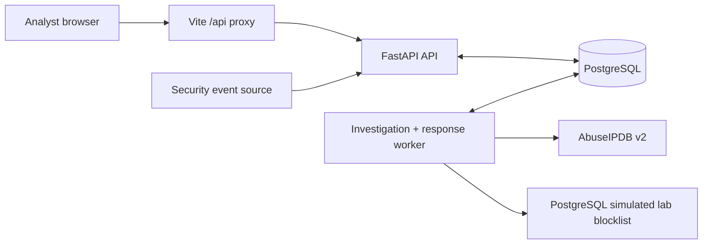

# SOAR Lite — Security Orchestration, Automation & Response

SOAR means **Security Orchestration, Automation, and Response**: it connects security signals, repeatable investigation steps, analyst decisions, and response records. SOAR Lite is a local-first prototype that demonstrates that loop without letting automation make containment decisions on its own.

For example, a monitoring system reports repeated suspicious logins from an IP address. SOAR Lite authenticates and stores the alert, investigates the IP with AbuseIPDB, lets an analyst authorize a **simulated** containment action, records every step, and allows reversal. It is built for local development, education, and portfolio demonstration—not production security operations.

## Screenshots and preview

The dashboard includes SOC Overview, Incident Explorer, Investigation Evidence, Response Actions/Audit Timeline, and Lab Blocklist views. Screenshot assets are not committed yet; add reviewed captures under [`docs/screenshots/`](docs/screenshots/) before referencing them here. A demo video is pending.

## Features

### Security alert ingestion

- Authenticated generic webhook with validation and payload-size limits.
- Persistent alert/incident creation and source-event deduplication.

### Automated investigation

- PostgreSQL-backed suspicious-IP queue, worker leases, bounded retries, and failure tracking.
- AbuseIPDB v2 enrichment with persisted evidence and status history.

### Human-approved response

- `block_ip` proposal, approval, rejection, approved-only execution, and persistent audit events.

### Simulated containment

- PostgreSQL-backed lab blocklist, action ownership, idempotent execution, and analyst-authorized reversal.
- **No host firewall, network, Docker, router, cloud, or production infrastructure is changed.**

### SOC dashboard

- React views for Overview, Incidents, Investigations, Response Actions, and Lab Blocklist.

## Technology stack

| Area | Technology | Role |
| --- | --- | --- |
| Frontend | React, TypeScript, Vite, Tailwind CSS | Analyst console and local API proxy. |
| Backend | Python, FastAPI, Pydantic | Validated REST APIs and application logic. |
| Persistence | PostgreSQL, SQLAlchemy, Alembic | Durable records, migrations, and worker state. |
| Background work | Python worker + PostgreSQL | Investigation and response polling with leases. |
| Intelligence | AbuseIPDB API v2 | External IP reputation enrichment. |
| Local deployment | Docker Compose | Starts the four local services. |
| Testing | Pytest | Unit and disposable-PostgreSQL integration coverage. |

## Quick Start

### Prerequisites

Required: [Git](https://git-scm.com/), [Docker Engine/Desktop](https://docs.docker.com/get-docker/), Docker Compose v2, Bash, OpenSSL, and curl. Docker supplies Python, Node.js, PostgreSQL, dependencies, and migrations for the standard path.

For the full live enrichment demonstration, also create an [AbuseIPDB API key](https://www.abuseipdb.com/api.html). It is optional for startup.

```bash
git clone https://github.com/sultanshahdev/soar-lite.git
cd soar-lite
bash scripts/setup.sh
bash scripts/start.sh
```

Open:

- Dashboard: <http://127.0.0.1:5173>
- Backend health: <http://127.0.0.1:8000/api/v1/health>
- FastAPI docs: <http://127.0.0.1:8000/docs>

Expected Compose services: `postgres`, `backend`, `worker`, and `frontend`. PostgreSQL is internal to Compose; it has no host port. The backend startup command applies Alembic migrations automatically.

## Secure configuration

`scripts/setup.sh` creates private `.env` from `.env.example` when needed and generates distinct random webhook and analyst secrets. It never overwrites a valid existing value. `.env` is ignored by Git; do not commit it or put credentials in frontend code.

| Variable | Purpose |
| --- | --- |
| `DATABASE_URL` | Backend/worker connection to the Compose PostgreSQL service. |
| `POSTGRES_DB`, `POSTGRES_USER`, `POSTGRES_PASSWORD` | PostgreSQL container initialization values. |
| `WEBHOOK_SECRET` | Bearer credential for incoming alert ingestion only. |
| `ANALYST_API_KEY` | Analyst API credential for the dashboard and analyst endpoints. |
| `ABUSEIPDB_API_KEY` | Provider credential for real IP enrichment. |

These are separate credentials. Enter the analyst key into the dashboard connection panel; it is held only in browser memory and is not production-grade user authentication. Without a valid AbuseIPDB key, ingestion and the UI still work, but real enrichment fails safely and is recorded by the investigation. Advanced worker timing and retry settings are listed in [.env.example](.env.example).

## First security alert

After startup, submit a fictional suspicious-login event with one command:

```bash
bash scripts/demo-alert.sh
```

The script reads—but never prints—the local webhook secret, creates a fresh event ID and UTC timestamp, builds the valid payload, submits it, and prints returned identifiers. It uses `8.8.8.8`, a public address accepted by the investigation policy. This is a fictional educational event: it does **not** mean Google DNS is malicious or attacking anything. No containment occurs until an analyst creates and approves a proposal.

## Walkthrough: complete SOAR demonstration

1. **Overview** — enter `ANALYST_API_KEY` in the dashboard and confirm counts update.
2. **Incidents** — find the new incident and review its related alert.
3. **Investigations** — find `8.8.8.8`. It moves through `queued`, `running`, `completed`, or `failed`.
4. **Threat intelligence** — open a completed investigation to inspect persisted AbuseIPDB confidence, report count, country (when supplied), provider, lookup time, and raw evidence. A low/zero score is still valid; the synthetic alert is not proof of malicious activity.
5. **Propose containment** — in **Response Actions**, choose the completed investigation and create the `block_ip` proposal. Proposal is intentionally separate from execution.
6. **Approve** — approve with an optional reason. The lifecycle is `proposed → approved → executing → executed`; approval only permits the worker to act.
7. **Inspect containment** — open **Lab Blocklist**. The IP should appear with its response action and incident reference after execution.
8. **Revert** — return to the executed action, choose Revert, then confirm its audit timeline and action-owned lab entry show reversal/inactive state.

The entire walkthrough is simulated containment; the host firewall is never changed.

## Architecture overview

SOAR Lite is a modular monolith: FastAPI and a separate worker process share PostgreSQL, while the React console communicates through Vite’s same-origin `/api` proxy.



Read the [Detailed Architecture](architecture.md) for flows, state machines, reliability, and security boundaries.

## Running, stopping, and troubleshooting

Start: `bash scripts/start.sh`.

Stop services while retaining database data: `docker compose --env-file .env -f infra/compose.yaml down`. Do **not** add `-v` unless you intentionally want to destroy the named PostgreSQL volume and all local data.

| Problem | Try |
| --- | --- |
| Docker daemon/socket error | Start Docker; on Linux, ensure your user has Docker socket access. |
| Port 5173/8000 busy | Stop the conflicting process or change `BACKEND_PORT` for backend. |
| Backend unavailable | `docker compose --env-file .env -f infra/compose.yaml logs backend` |
| Dashboard cannot reach API | Confirm health URL and inspect frontend/backend logs. |
| Analyst key rejected | Re-enter `ANALYST_API_KEY`; do not use `WEBHOOK_SECRET`. |
| Webhook returns 401 | Run `bash scripts/setup.sh` or check the private webhook secret. |
| Investigation failed | Configure a valid AbuseIPDB key; check worker logs for auth/rate-limit/provider errors. |
| No incidents appear | Run `bash scripts/demo-alert.sh`, then refresh the dashboard. |
| Migrations issue | `docker compose --env-file .env -f infra/compose.yaml run --rm backend alembic upgrade head` |

## Testing

```bash
# Backend tests (integration tests need TEST_DATABASE_URL)
cd backend && uv run pytest -q

# React production build
cd frontend && npm run build

# Compose configuration
docker compose --env-file .env -f infra/compose.yaml config
```

Database integration and lifecycle acceptance tests require a **separate disposable** database URL whose name contains `soar_lite_test`; their fixtures erase only that test schema. Never target the normal application database.

```bash
cd backend
TEST_DATABASE_URL=postgresql+psycopg://.../soar_lite_test \
  uv run pytest -q tests/test_end_to_end_acceptance_postgres.py
```

Unit tests validate isolated logic. PostgreSQL integration tests validate persistence, leases, and API state. The acceptance test uses a mocked AbuseIPDB boundary while exercising real APIs, workers, and PostgreSQL. A browser walkthrough remains a separate live check.

## Scope and limitations

SOAR Lite is local-first and intentionally constrained: one suspicious-IP workflow, shared analyst API-key auth, no per-user identity/RBAC, no SIEM/EDR integrations, no generalized visual playbook editor, no enterprise availability guarantees, and no real containment. AbuseIPDB enrichment requires provider connectivity and valid credentials. These are deliberate safety and delivery boundaries.

## Repository structure

```text
backend/                 FastAPI app, workers, migrations, and pytest suite
  app/api/               Ingestion, analyst, investigation, and response routes
  app/workers/           PostgreSQL-backed investigation and response processors
  app/connectors/        AbuseIPDB and simulated lab response adapters
  migrations/            Alembic migrations
  tests/                 Unit, integration, and lifecycle acceptance tests
frontend/                React/Vite SOC dashboard
infra/compose.yaml       Local PostgreSQL, API, worker, and frontend services
scripts/                 setup, startup, and demo-alert helpers
architecture.md          Detailed technical architecture
.env.example             Safe configuration template
```

## Further documentation

- [Detailed Architecture](architecture.md)
- [FastAPI documentation](http://127.0.0.1:8000/docs) when the stack is running
- [AbuseIPDB API documentation](https://docs.abuseipdb.com/)
- [Docker Compose documentation](https://docs.docker.com/compose/)
