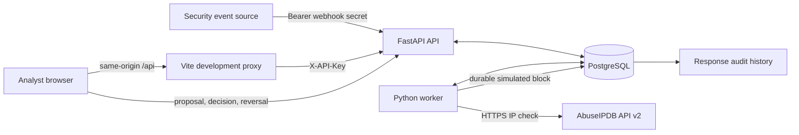
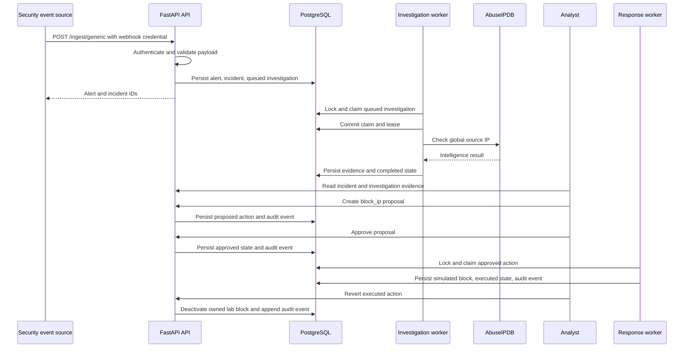
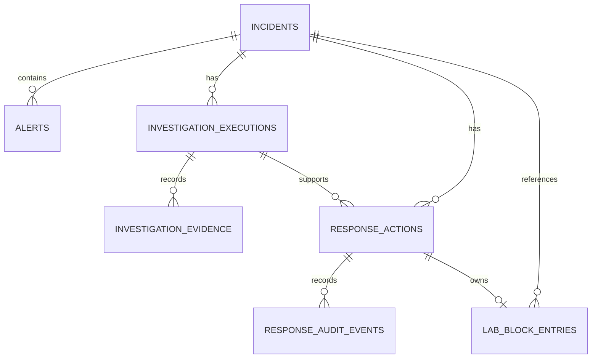
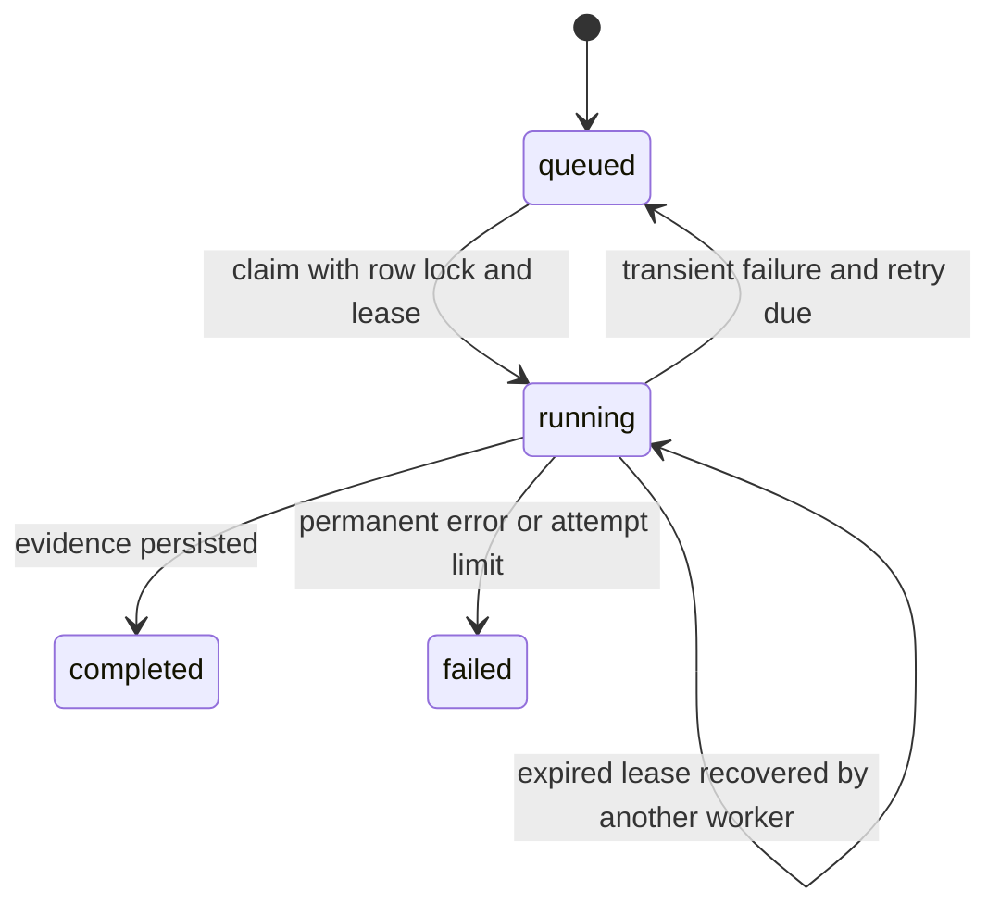
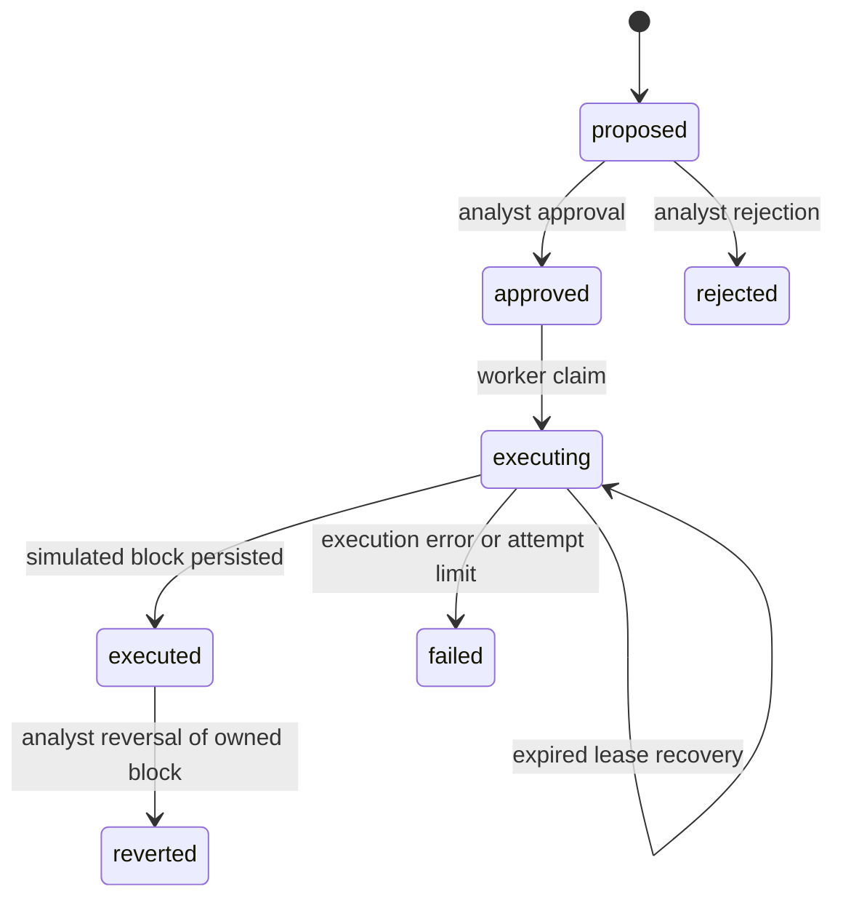
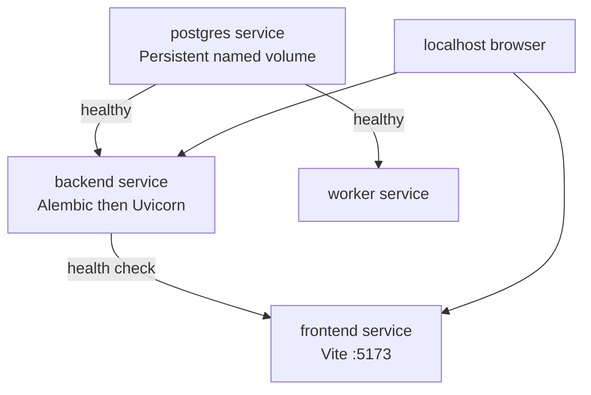

# SOAR Lite Architecture

## 1. System overview

SOAR Lite is a local-first prototype for turning an authenticated security alert into a durable investigation, an analyst-approved simulated response, and a reversible audit trail. It uses a modular monolith: FastAPI serves the API, a separate Python process polls durable work, and both share PostgreSQL. React is a separate client application.

The response boundary is intentional. The only containment implementation is a PostgreSQL lab blocklist. It never invokes a shell or alters host networking, iptables/nftables/UFW, Docker networking, routers, cloud controls, or real production infrastructure.

## 2. High-level components

The browser does not receive provider, webhook, or database credentials. In Compose, the frontend proxies `/api` to `backend`; the browser therefore uses a same-origin route instead of broad CORS access.

## 3. Component responsibilities

| Component | Responsibility | Relevant paths |
| --- | --- | --- |
| React SOC frontend | Displays operational data and submits analyst-authenticated actions. | `frontend/src/App.tsx`, `frontend/src/api.ts` |
| Vite proxy | Routes browser `/api` requests to the internal backend service. | `frontend/vite.config.ts` |
| FastAPI REST API | Validates input, authenticates requests, exposes persisted records. | `backend/app/api/` |
| Authentication dependencies | Validates webhook bearer and analyst `X-API-Key` values, fail-closed. | `backend/app/security/auth.py` |
| Ingestion service | Deduplicates an alert, creates its incident, queues eligible work. | `backend/app/domain/alerts/service.py` |
| Investigation processor | Claims durable work, calls intelligence, persists evidence/retries. | `backend/app/workers/investigations.py` |
| AbuseIPDB connector | Validates global IPs and normalizes provider responses/errors. | `backend/app/connectors/abuseipdb.py` |
| Response processor | Claims approved actions and persists simulated execution outcome. | `backend/app/workers/responses.py` |
| Lab response adapter | Maintains action-owned simulated blocks in PostgreSQL. | `backend/app/connectors/lab_response.py` |
| Audit persistence | Appends proposal, decision, execution, and reversal events. | `ResponseAuditEvent` model/API |
| PostgreSQL | Application records plus durable queue/lease state. | `backend/app/persistence/models.py` |
| Alembic | Evolves the PostgreSQL schema. | `backend/migrations/` |
| Docker Compose | Starts PostgreSQL, API, worker, and frontend locally. | `infra/compose.yaml` |

## 4. End-to-end sequence

The human approval gate occurs before the response worker can claim work. The investigation worker commits its claim before external HTTP I/O; the provider call is not held inside an open claim transaction.

## 5. Database architecture

`Alert` is unique on `(source, source_event_id)`. `InvestigationExecution` is unique on `(incident_id, investigation_type, source_ip)`. A partial unique index prevents more than one active (`proposed`, `approved`, or `executing`) response action for the same incident, action type, and target IP. `LabBlockEntry` is unique per response action, which makes a repeated logical response idempotent and preserves ownership for reversal.

JSONB stores original alert payloads, normalized evidence, execution results, audit metadata, and simulated-block metadata. PostgreSQL is both the application database and durable worker queue because the prototype needs transactional state, locks, and recovery without a second broker.

## 6. Investigation state machine

Claims use `FOR UPDATE SKIP LOCKED`, a lease token/owner, and an expiration time. Completion and failure updates are fenced by the token, so a stale worker cannot overwrite a newer claim. Retries are bounded with exponential scheduling for transient provider failures. Provider calls are at-least-once across a crash boundary: a crash after an external request but before persistence can repeat the lookup after lease expiry. Evidence writes are lease-token guarded; exactly-once external calls are not claimed.

## 7. Response state machine

Only an authenticated analyst creates, approves, rejects, or reverts an action. Approval merely persists `approved`; it never executes containment in the HTTP request. The worker only claims persisted approved actions (or safely recovers an expired executing lease). It appends audit events as it transitions state.

## 8. Concurrency and reliability

- Alert deduplication is enforced by a database uniqueness constraint.
- Ingestion records related alert/incident/investigation data transactionally.
- Investigation and response claims use row-level locks and `SKIP LOCKED` to exclude competing workers.
- Lease expiration enables recovery; lease tokens fence stale completion.
- Retry limits bound failed external investigation attempts.
- The response block entry is action-owned and unique, so retries do not create duplicate logical blocks.
- Reverting deactivates only the selected action’s entry. If another action still owns an active block for the same IP, it remains active.

Remaining limitations include a single database-backed polling topology, no distributed scheduler, at-least-once provider lookup semantics, and no exactly-once claim across every possible process/database failure.

## 9. Security architecture

Trust boundaries are explicit:

- **Webhook sender → API:** `Authorization: Bearer` is compared with `WEBHOOK_SECRET`; payload fields are validated.
- **Analyst browser → API:** `X-API-Key` is compared with `ANALYST_API_KEY`; the key is held in browser memory only.
- **API/worker → PostgreSQL:** credentials live in private environment configuration; the Compose database remains internal.
- **Worker → AbuseIPDB:** an API key is sent only to the provider over HTTPS; safe error categories are persisted rather than credentials.
- **Worker → response adapter:** the adapter changes only PostgreSQL data, never host/network controls.

Compose exposes frontend and backend only on localhost. The shared analyst key intentionally lacks individual identity, RBAC, and production-grade access control. It is an MVP development mechanism, not a production authentication design. Response actions cannot execute arbitrary shell commands or target arbitrary IPs outside the completed supporting investigation.

## 10. Deployment architecture

Compose waits for PostgreSQL health before backend/worker start. Backend runs `alembic upgrade head` before Uvicorn. Frontend starts Vite and proxies internally to backend. Named PostgreSQL storage persists across normal `docker compose down`; only explicit volume removal destroys it. Backend and frontend ports bind to localhost.

## 11. Design decisions and trade-offs

| Decision | Why it fits this MVP | Trade-off |
| --- | --- | --- |
| PostgreSQL worker, not Redis/Celery | Reuses one durable system for locks, state, and migrations. | Polling and scaling are simpler but less flexible than a dedicated broker. |
| Fixed suspicious-IP workflow | Keeps the security flow reviewable and deliverable. | No configurable/generalized playbooks. |
| Human approval | Prevents intelligence data from directly triggering containment. | Response is slower than autonomous automation. |
| Simulated containment | Demonstrates orchestration without affecting infrastructure. | Does not enforce a real network block. |
| Shared analyst key | Minimal local setup. | No individual identity or RBAC. |
| Modular monolith | Low operational overhead and shared code/database. | Not independently scalable microservices. |

## 12. Limitations and future extensions

Implemented: authenticated ingestion, one persistent suspicious-IP workflow, real AbuseIPDB connector, analyst-approved simulated response, reversal, audit trail, and React SOC console.

Possible future work—not currently implemented—includes per-user authentication/RBAC, more alert and intelligence integrations, configurable playbooks, enterprise audit/observability, production secret management, carefully governed real response adapters, horizontal worker scaling, and browser automation.
